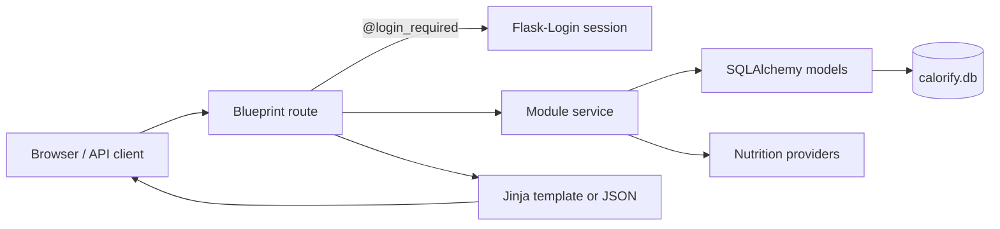
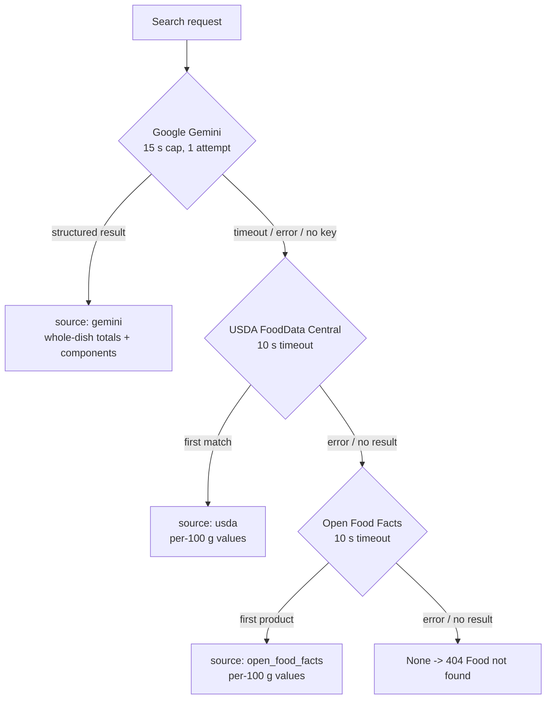

# Calorify — System Architecture

## 1. Overview

Calorify is a modular Flask application. Functionality is divided into five functional modules — **Authentication**, **Profile**, **Nutrition**, **Meals** and **Reports** — each implemented as its own Python package with a Flask blueprint. A shared `core` package provides configuration, extensions and helpers.

The codebase follows:

* Modular programming — one package per functional module.
* Separation of concerns — routes, services, models and external providers live in separate files.
* Clean Code principles — small functions, meaningful names, no logic in `main.py`.

## 2. Technology Stack

| Layer | Technology |
| --- | --- |
| Backend | Python 3.11, Flask 3.1.3 |
| ORM | Flask-SQLAlchemy 3.1.1 (SQLAlchemy 2.1.2) |
| Database | SQLite (`calorify.db` file) |
| Authentication | Flask-Login 0.6.3 (session cookies) |
| Nutrition providers | Google Gemini via the `google-genai` SDK, USDA FoodData Central, Open Food Facts |
| HTTP client | `requests` (10 s timeouts) |
| Response validation | Pydantic models (Gemini structured output) |
| Frontend | Jinja2 templates, Bootstrap 5.3.3 (CDN), custom CSS (`static/css/style.css`), vanilla JavaScript (`static/js/script.js`) |
| Configuration | `python-dotenv` loading a `.env` file |
| Testing | Pytest 9.1.1 |

## 3. Project Structure

```text
Calorify/
├── main.py                     # Entry point: creates and runs the app
├── requirements.txt
├── calorify.db                 # SQLite database (git-ignored)
├── .env / .env.example         # Environment variables (.env git-ignored)
├── app/
│   ├── __init__.py             # Application factory (create_app)
│   ├── core/
│   │   ├── config.py           # Config class (SECRET_KEY, database URI)
│   │   ├── extensions.py       # db (SQLAlchemy), login_manager instances
│   │   ├── http.py             # wants_json() content negotiation helper
│   │   └── exceptions.py       # Custom application exceptions
│   ├── authentication/
│   │   ├── routes.py           # /auth blueprint: login, register, logout
│   │   └── service.py          # Hashing, register_user, login_user
│   ├── profile/
│   │   ├── models.py           # User and Profile models
│   │   ├── routes.py           # /profile blueprint
│   │   └── service.py          # BMI, calorie & macro calculations
│   ├── nutrition/
│   │   ├── routes.py           # /nutrition blueprint: search, guest page
│   │   ├── service.py          # Provider fallback chain
│   │   └── providers/
│   │       ├── gemini.py       # Gemini structured-output provider
│   │       ├── usda.py         # USDA FoodData Central provider
│   │       └── open_food_facts.py
│   ├── meals/
│   │   ├── models.py           # Meal model
│   │   ├── routes.py           # /meals blueprint (CRUD)
│   │   └── service.py          # Meal operations and validation
│   ├── reports/
│   │   ├── routes.py           # /reports blueprint: daily, weekly, dashboard
│   │   ├── service.py          # Daily and weekly aggregation
│   │   └── charts.py           # Empty placeholder (charts are CSS-rendered)
│   ├── templates/              # Jinja2 templates per module
│   └── static/                 # style.css, script.js, favicon.svg
├── tests/                      # Pytest suite (see docs/testing.md)
└── docs/                       # Project documentation
```

## 4. Application Factory and Startup

`app/__init__.py` defines `create_app()`:

1. `load_dotenv()` loads `.env` at import time (API keys, `SECRET_KEY`).
2. A `Flask` app is created and configured from `app.core.config.Config` (secret key and the SQLite URI pointing at `calorify.db` in the project root).
3. The shared extensions `db` and `login_manager` (created once in `core/extensions.py`) are initialised with the app.
4. All five module blueprints are registered.
5. A context processor injects `user_profile` (the current user's `Profile` row, or `None`) into every template, so the sidebar can display the calorie goal.
6. A root route `/` redirects authenticated users to the dashboard and anonymous users to the login page.

`main.py` only calls `create_app()` and runs the development server (`debug=True`).

**Note:** `create_app()` does **not** call `db.create_all()`. Database tables must be created once manually (see `docs/database_design.md` §6); the test suite creates its own throwaway database.

## 5. Modules and Blueprints

| Module | Blueprint name | URL prefix | Responsibility |
| --- | --- | --- | --- |
| Authentication | `authentication` | `/auth` | Registration, login, logout, password hashing |
| Profile | `profile` | `/profile` | Body details, calorie/macro targets, password change, data export, account deletion |
| Nutrition | `nutrition` | `/nutrition` | Food search, provider fallback, guest search |
| Meals | `meals` | `/meals` | Meal CRUD, ownership checks, category validation |
| Reports | `reports` | `/reports` | Daily/weekly aggregation, dashboard |

Module interactions are deliberately thin:

* Authentication and Profile share the `User` model and the hashing helpers in `authentication/service.py`.
* Nutrition calls `reports/service.get_daily_report()` so the search page can show how a food fits into today's goals.
* Reports reads the `Meal` model and `meals/service.get_user_meals()` to build summaries.
* The dashboard template posts new meals to the Meals API via JavaScript.

## 6. Application Layers

| Layer | Location | Role |
| --- | --- | --- |
| Routes | `<module>/routes.py` | Receive requests, validate input, choose HTML or JSON response |
| Services | `<module>/service.py` | Business logic and database operations |
| Models | `profile/models.py`, `meals/models.py` | SQLAlchemy table definitions |
| Providers | `nutrition/providers/` | Communication with external nutrition APIs |
| Templates | `app/templates/` | Jinja2 pages, one folder per module |
| Static | `app/static/` | CSS, JavaScript, favicon |
| Core | `app/core/` | Config, shared extensions, custom exceptions, `wants_json()` helper |

`core/exceptions.py` defines the application's exception hierarchy: `CalorifyError` (base), `EmailAlreadyRegisteredError` (raised by the registration service), `InvalidMealTypeError` (raised by the meal service), and `NutritionProviderError` with its subclass `ProviderNotConfiguredError` (raised by the Gemini and USDA providers when their API key is missing). Services raise these instead of returning `None` sentinels, and routes catch them to produce the corresponding error responses. `reports/charts.py` remains an empty placeholder; all charts are rendered with CSS/Jinja rather than generated server-side.

## 7. Request Flow

A typical authenticated page request:

1. The browser sends a request; Flask routes it to the matching blueprint endpoint.
2. `@login_required` checks the session (Flask-Login loads the user via the `user_loader` callback in `app/__init__.py`).
3. The route validates input and calls its module's service function.
4. The service performs the logic, querying or updating models through the shared `db` session.
5. The route returns either a rendered Jinja template (browsers) or JSON (API clients) — see §8.
6. For interactive actions (logging, editing, deleting meals), `static/js/script.js` calls the JSON endpoints with `fetch()` and reloads the page on success.



## 8. Content Negotiation

Several endpoints serve both the web UI and JSON from the same URL. The helper `core/http.wants_json()` returns `True` only when the client's `Accept` header ranks `application/json` above `text/html`. Browsers therefore always get HTML, while API clients sending `Accept: application/json` get JSON. Endpoints using this: `GET /meals/`, `GET /nutrition/search`, `GET /reports/weekly`. `GET /reports/daily` is JSON-only; the dashboard is HTML-only; the meal create/update/delete endpoints are JSON-only.

## 9. Nutrition Provider Fallback

`nutrition/service.search_food(food_name, quantity_grams, meat_weight_grams)` tries providers in a fixed order and returns `{"source": <provider>, "food": <data>}` or `None`:



### 9.1 Google Gemini (primary)

* Requires `GEMINI_API_KEY`; if it is missing the provider raises immediately and the chain falls through.
* Runs in a `ThreadPoolExecutor` with a 15-second result timeout, and the SDK itself is configured with a 15-second HTTP timeout and a single attempt, so an overloaded model cannot hang the request.
* Sends a structured prompt (model `gemini-3.8-flash`) that instructs the model to: read quantities from the food text or the explicit parameters (explicit parameters win), decompose mixed dishes (biryani, pulao, karahi, curry/salan, daal chawal, haleem, …) into components (meat, rice/gravy, absorbed oil and other preparation ingredients), never double-count the meat weight (it is already part of the total; the non-meat portion is `total − meat`), sum components to whole-dish totals, and mark cooked/mixed dishes with `estimate: true`.
* The response is forced to JSON matching the Pydantic `NutritionResult` schema: `name`, `quantity_grams`, `meat_weight_grams`, `calories`, `protein`, `carbohydrates`, `fats`, `estimate`, and an optional `components` list (`name`, `grams`, `calories`, `protein`, `carbohydrates`, `fats` each).
* **Limitation:** the decomposition arithmetic is performed by the model under prompt instructions. The application validates the response *shape* with Pydantic but does not numerically re-verify that component grams and calories sum to the totals at runtime (the test suite checks this property on a sample payload).

### 9.2 USDA FoodData Central (first fallback)

* Requires `USDA_API_KEY`. Calls `GET https://api.nal.usda.gov/fdc/v1/foods/search` and takes the **first** result.
* Maps nutrient names (energy, protein, carbohydrate, total lipid) to a flat result with `serving_size: 100`, `serving_unit: "g"` — values are per 100 g.
* Ignores `quantity` and `meat_weight`; no component breakdown.

### 9.3 Open Food Facts (second fallback)

* No API key required. Calls the public search endpoint with a project-specific User-Agent and takes the **first** product's `nutriments` per-100 g values.
* Same flat shape and limitations as USDA.

### 9.4 Error handling in the chain

Each provider call is wrapped in `try/except`; a timeout or exception moves to the next provider. If all three fail, the route returns 404 ("Food not found") when the chain returns `None`, or 503/500 ("service temporarily unavailable") when an unexpected error escapes.

## 10. Profile Calculations

Implemented in `profile/service.py`:

* **BMR** — Mifflin–St Jeor: `10·weight(kg) + 6.25·height(cm) − 5·age + 5` (male) or `− 161` (female).
* **Activity multipliers** — sedentary 1.2, light 1.375, moderate 1.55, active 1.725 (unknown values default to 1.2).
* **Goal adjustment** — lose: −550 kcal (0.5 kg/week) or −1100 kcal (1 kg/week); gain: +300 kcal; maintain: no change. The result is rounded and floored at 1200 kcal.
* **Macro targets** — 21% of calories as protein, 54% as carbohydrates, 25% as fat, converted to grams (÷4, ÷4, ÷9).
* **BMI** — `weight / height²` (kg/m²), with warnings below 18.5 and at 30 or above.

These are standard population-level estimates, not medical advice.

## 11. Authentication and Protected Routes

* Sessions are managed by Flask-Login; the `user_loader` fetches the `User` by primary key.
* All Profile, Meals and Reports routes use `@login_required`. Nutrition search and the guest page are public; logged-in users get the full "Calorie Check" page, guests a standalone guest page (`_search_template()` chooses between them).
* Logout is a `POST` route.
* **Known limitation:** `login_manager.login_view` is not configured, so unauthenticated requests to protected routes receive HTTP `401 Unauthorized` instead of a redirect to `/auth/login`.
* **Known limitation:** there is no CSRF protection on forms or the JSON endpoints (Flask-WTF is not used).

## 12. Error Handling and Validation

* Route-level validation: required-field checks, numeric conversion with `try/except`, email regex and password length on registration, date parsing (`YYYY-MM-DD`), positive-number checks on search quantities, and meal-type whitelisting (`breakfast`, `lunch`, `dinner`, `snack`).
* Service-level failures raise the custom exceptions from `core/exceptions.py` (duplicate email, invalid meal type, unconfigured provider); routes catch them and translate them into the error responses below.
* HTML flows re-render the page with an `error` (or `password_error`/`success`) message; JSON flows return `{"message": ...}` with 400/404/500-style status codes.
* Ownership checks: meal queries always filter by `user_id`, so another user's meal is indistinguishable from a missing one (404).

## 13. Frontend Integration

* `base.html` loads Bootstrap 5.3.3 and the Inter font from CDNs plus the custom stylesheet; authenticated pages replace the navbar with a sidebar (`_sidebar.html`).
* `static/js/script.js` implements: the light/dark theme toggle (persisted in `localStorage`), the meal log/edit modal (POST/PUT to `/meals/`), meal deletion, "add to today" re-logging, client-side meal search/filtering, the search loading state, quick-pick buttons, recent checks (`localStorage`), guest session history (`sessionStorage`), and the dashboard water tracker (per-day `localStorage`; not persisted server-side).
* Charts (weekly bar chart with goal line, macro-split donut, calorie/macro progress rings, dashboard mini chart) are rendered purely with CSS and Jinja-computed inline styles — there is no JavaScript charting library.
