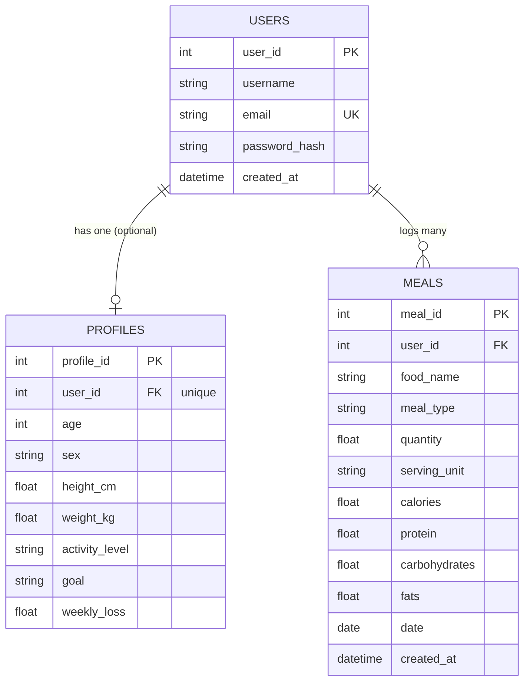

# Calorify — Database Design

## 1. Database Technology

Calorify uses **SQLite** with **Flask-SQLAlchemy** as the ORM. The database is a single file, `calorify.db`, in the project root; the URI is built in `app/core/config.py` and the file is excluded from version control via `.gitignore`.

There are three tables, defined in two model files:

| Table | Model class | Defined in |
| --- | --- | --- |
| `users` | `User` | `app/profile/models.py` |
| `profiles` | `Profile` | `app/profile/models.py` |
| `meals` | `Meal` | `app/meals/models.py` |

## 2. Entity Relationships



* One user has **at most one** profile (`profiles.user_id` is unique). A user may exist without a profile until they complete the profile form.
* One user has **many** meals.
* The models do not define SQLAlchemy `relationship()` navigation properties; related rows are always fetched with explicit queries filtered by `user_id`.

## 3. Table Definitions

### 3.1 `users` — account and authentication data

| Column | Type | Constraints | Description |
| --- | --- | --- | --- |
| `user_id` | Integer | Primary key | Unique user identifier |
| `username` | String(100) | Not null | Display name |
| `email` | String(120) | Unique, not null | Login identifier; uniqueness enforces one account per email |
| `password_hash` | String(255) | Not null | Werkzeug salted password hash (never plain text) |
| `created_at` | DateTime | Not null | Account creation timestamp (UTC, set by the registration service) |

`User` extends Flask-Login's `UserMixin`; `get_id()` returns `user_id` as a string for the session cookie.

### 3.2 `profiles` — body details and daily goals

| Column | Type | Constraints | Description |
| --- | --- | --- | --- |
| `profile_id` | Integer | Primary key | Unique profile identifier |
| `user_id` | Integer | Foreign key → `users.user_id`, unique, not null | Owning user (unique ⇒ one profile per user) |
| `age` | Integer | Nullable | Age in years |
| `sex` | String(20) | Nullable | `male` / `female`; used in the BMR equation |
| `height_cm` | Float | Nullable | Height in centimetres |
| `weight_kg` | Float | Nullable | Weight in kilograms |
| `activity_level` | String(50) | Nullable | `sedentary`, `light`, `moderate` or `active` |
| `goal` | String(50) | Nullable | `lose`, `maintain` or `gain` |
| `weekly_loss` | Float | Nullable | Selected weight-loss pace in kg/week |

The descriptive columns are nullable at the schema level. Profile routes validate required fields before saving. The application computes calorie and macro targets on read using the stored profile inputs.

### 3.3 `meals` — logged meals

| Column | Type | Constraints | Description |
| --- | --- | --- | --- |
| `meal_id` | Integer | Primary key | Unique meal identifier |
| `user_id` | Integer | Foreign key → `users.user_id`, not null | Owning user |
| `food_name` | String(200) | Not null | Name of the food or dish |
| `meal_type` | String(20) | Not null | `breakfast`, `lunch`, `dinner` or `snack` (validated and lower-cased in the service layer) |
| `quantity` | Float | Not null | Amount consumed |
| `serving_unit` | String(50) | Not null | Unit, e.g. `g` or `serving` |
| `calories` | Float | Not null | Calories for this entry (kcal) |
| `protein` | Float | Not null | Protein (g) |
| `carbohydrates` | Float | Not null | Carbohydrates (g) |
| `fats` | Float | Not null | Fat (g) |
| `date` | Date | Not null, default = today | The day the meal counts toward |
| `created_at` | DateTime | Not null, default = UTC now | Record creation timestamp (used as a secondary sort key) |

Each meal stores a **snapshot** of its nutrition values. Historical records therefore remain stable even if an external provider later returns different values for the same food.

## 4. Keys and Integrity

* Integer primary keys are `users.user_id`, `profiles.profile_id`, and `meals.meal_id`. SQLite allocates user IDs with `AUTOINCREMENT` on new databases and on the cleaned sample database.
* Foreign keys: `profiles.user_id` and `meals.user_id` both reference `users.user_id`.
* Uniqueness: `users.email` and `profiles.user_id`.
* The application enables SQLite foreign-key enforcement on every connection.
* **No cascade rules are configured on the foreign keys.** Account deletion (`POST /profile/delete`) therefore deletes the user's meals and profile explicitly before deleting the `users` row, all in one route-level transaction.
* Data isolation is enforced in queries: every profile, meal and report query filters by the logged-in `user_id`.

## 5. Normalization

| Form | How the schema satisfies it |
| --- | --- |
| 1NF | Columns store single values. Each meal has its own row with one owner, quantity, unit, and set of nutrition totals. |
| 2NF | Each candidate key has one column, so there are no partial-key dependencies. |
| 3NF | The profile stores the inputs to its targets. Calories are calculated from those inputs and macros are calculated from the calorie target. Meal totals are snapshots of a specific logged portion, so the food label alone cannot determine them. |
| 4NF | The independent collection of meals lives in its own table. A profile has a single row per user, and no table combines independent repeating facts. |
| 5NF | Under the application's business rules, the remaining row facts depend on simple candidate keys. There are no additional join dependencies that require decomposing these tables. [Date and Fagin on simple keys and higher normal forms](https://research.ibm.com/publications/simple-conditions-for-guaranteeing-higher-normal-forms-in-relational-databases). |

## 6. How Data Is Stored

* SQLite stores everything in the single `calorify.db` file; Flask-SQLAlchemy manages connections and sessions through the shared `db` object in `app/core/extensions.py`.
* Writes go through `db.session` with an explicit `commit()` in each service function.
* Dates are stored as `DATE` (meal day) and `DATETIME` (timestamps, UTC); SQLAlchemy converts them to Python `date`/`datetime` objects.

## 7. Database Initialization

`create_app()` does **not** modify tables automatically. Create or upgrade the configured database with:

```powershell
python -m flask --app main init-db
```

Initialization upgrades older profiles by adding the weekly loss input if needed and dropping the stored target columns. SQLite 3.35 or later is required to drop legacy columns. The test suite uses a separate temporary database for each test.

## 8. Scope

The database intentionally contains only these three tables. A food catalogue table is not maintained because nutrition data comes from external providers at search time, and the dashboard's water tracker is stored only in the browser (`localStorage`), not in the database.
