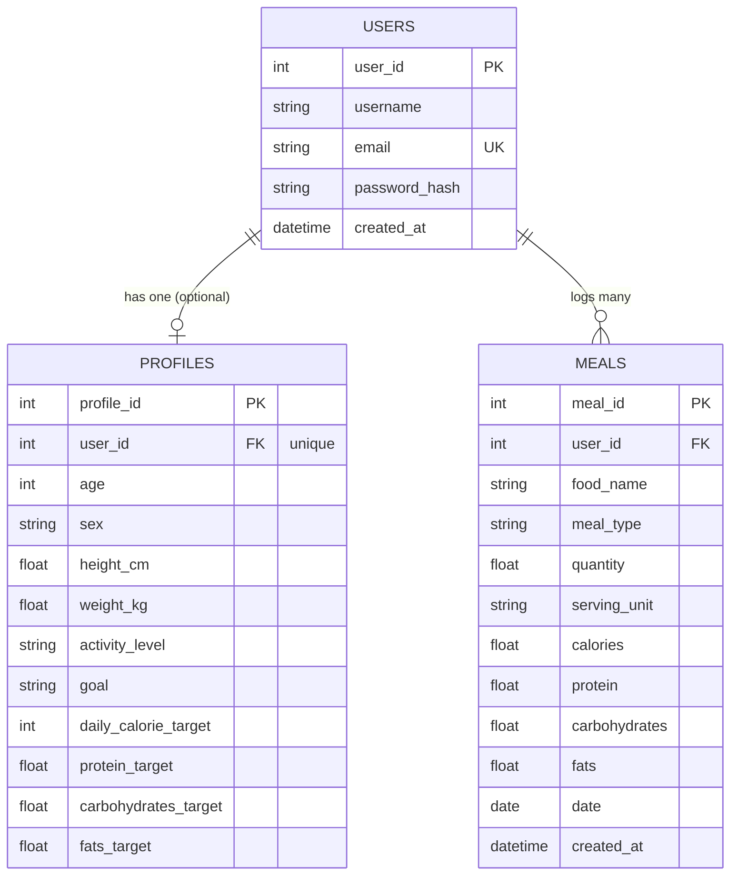

# Calorify — Database Design

## 1. Database Technology

Calorify uses **SQLite** with **Flask-SQLAlchemy** as the ORM. The database is a single file, `calorify.db`, in the project root; the URI is built in `app/core/config.py` and the file is excluded from version control via `.gitignore`.

There are three tables, defined in two model files:

| Table | Model class | Defined in |
| --- | --- | --- |
| `users` | `User` | `app/profile/models.py` |
| `profiles` | `Profile` | `app/profile/models.py` |
| `meals` | `Meal` | `app/meals/models.py` |

## 2. Entity Relationships



* One user has **at most one** profile (`profiles.user_id` is unique). A user may exist without a profile until they complete the profile form.
* One user has **many** meals.
* The models do not define SQLAlchemy `relationship()` navigation properties; related rows are always fetched with explicit queries filtered by `user_id`.

## 3. Table Definitions

### 3.1 `users` — account and authentication data

| Column | Type | Constraints | Description |
| --- | --- | --- | --- |
| `user_id` | Integer | Primary key | Unique user identifier |
| `username` | String(100) | Not null | Display name |
| `email` | String(120) | Unique, not null | Login identifier; uniqueness enforces one account per email |
| `password_hash` | String(255) | Not null | Werkzeug salted password hash (never plain text) |
| `created_at` | DateTime | Not null | Account creation timestamp (UTC, set by the registration service) |

`User` extends Flask-Login's `UserMixin`; `get_id()` returns `user_id` as a string for the session cookie.

### 3.2 `profiles` — body details and daily goals

| Column | Type | Constraints | Description |
| --- | --- | --- | --- |
| `profile_id` | Integer | Primary key | Unique profile identifier |
| `user_id` | Integer | Foreign key → `users.user_id`, unique, not null | Owning user (unique ⇒ one profile per user) |
| `age` | Integer | Nullable | Age in years |
| `sex` | String(20) | Nullable | `male` / `female`; used in the BMR equation |
| `height_cm` | Float | Nullable | Height in centimetres |
| `weight_kg` | Float | Nullable | Weight in kilograms |
| `activity_level` | String(50) | Nullable | `sedentary`, `light`, `moderate` or `active` |
| `goal` | String(50) | Nullable | `lose`, `maintain` or `gain` |
| `daily_calorie_target` | Integer | Nullable | Calculated daily calorie goal (kcal) |
| `protein_target` | Float | Nullable | Calculated daily protein goal (g) |
| `carbohydrates_target` | Float | Nullable | Calculated daily carbohydrate goal (g) |
| `fats_target` | Float | Nullable | Calculated daily fat goal (g) |

The descriptive columns are nullable at the schema level; required-field validation happens in the profile routes before a row is created or updated. The three target columns and `daily_calorie_target` are always set by the service layer (`create_profile` / `update_profile`), never by user input.

### 3.3 `meals` — logged meals

| Column | Type | Constraints | Description |
| --- | --- | --- | --- |
| `meal_id` | Integer | Primary key | Unique meal identifier |
| `user_id` | Integer | Foreign key → `users.user_id`, not null | Owning user |
| `food_name` | String(200) | Not null | Name of the food or dish |
| `meal_type` | String(20) | Not null | `breakfast`, `lunch`, `dinner` or `snack` (validated and lower-cased in the service layer) |
| `quantity` | Float | Not null | Amount consumed |
| `serving_unit` | String(50) | Not null | Unit, e.g. `g` or `serving` |
| `calories` | Float | Not null | Calories for this entry (kcal) |
| `protein` | Float | Not null | Protein (g) |
| `carbohydrates` | Float | Not null | Carbohydrates (g) |
| `fats` | Float | Not null | Fat (g) |
| `date` | Date | Not null, default = today | The day the meal counts toward |
| `created_at` | DateTime | Not null, default = UTC now | Record creation timestamp (used as a secondary sort key) |

Each meal stores a **snapshot** of its nutrition values. Historical records therefore remain stable even if an external provider later returns different values for the same food.

## 4. Keys and Integrity

* Primary keys: `users.user_id`, `profiles.profile_id`, `meals.meal_id` (all auto-incrementing integers).
* Foreign keys: `profiles.user_id` and `meals.user_id` both reference `users.user_id`.
* Uniqueness: `users.email` and `profiles.user_id`.
* **No cascade rules are configured on the foreign keys.** Account deletion (`POST /profile/delete`) therefore deletes the user's meals and profile explicitly before deleting the `users` row, all in one route-level transaction.
* Data isolation is enforced in queries: every profile, meal and report query filters by the logged-in `user_id`.

## 5. How Data Is Stored

* SQLite stores everything in the single `calorify.db` file; Flask-SQLAlchemy manages connections and sessions through the shared `db` object in `app/core/extensions.py`.
* Writes go through `db.session` with an explicit `commit()` in each service function.
* Dates are stored as `DATE` (meal day) and `DATETIME` (timestamps, UTC); SQLAlchemy converts them to Python `date`/`datetime` objects.

## 6. Database Initialization

`create_app()` does **not** create tables automatically. The tables are created once from the models with:

```powershell
python -c "from app import create_app; from app.core.extensions import db; app = create_app(); ctx = app.app_context(); ctx.push(); db.create_all()"
```

(or the equivalent `db.create_all()` inside `flask shell`). The repository contains a ready `calorify.db` in development, so this step is only needed for a fresh setup.

The **test suite** never touches the real database: `tests/conftest.py` repoints `Config.SQLALCHEMY_DATABASE_URI` at a throwaway file in the system temp directory and recreates all tables (`drop_all` + `create_all`) before every test.

There is no migration tool (e.g. Alembic / Flask-Migrate); schema changes require recreating the database file. This is acceptable at the current project scale and is a known limitation.

## 7. Scope

The database intentionally contains only these three tables. A food catalogue table is not maintained because nutrition data comes from external providers at search time, and the dashboard's water tracker is stored only in the browser (`localStorage`), not in the database.
